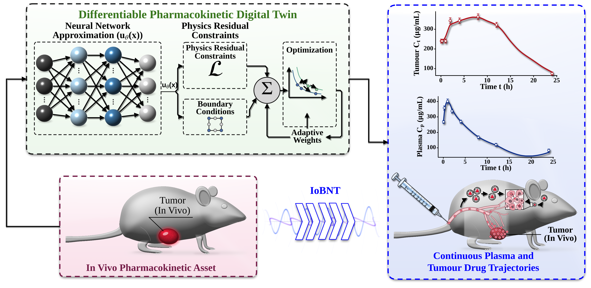
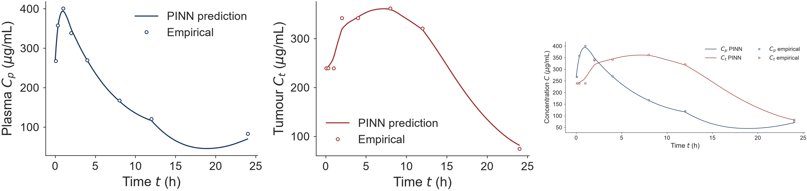
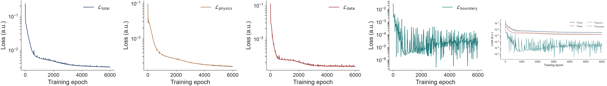
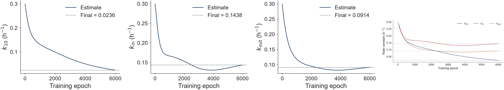
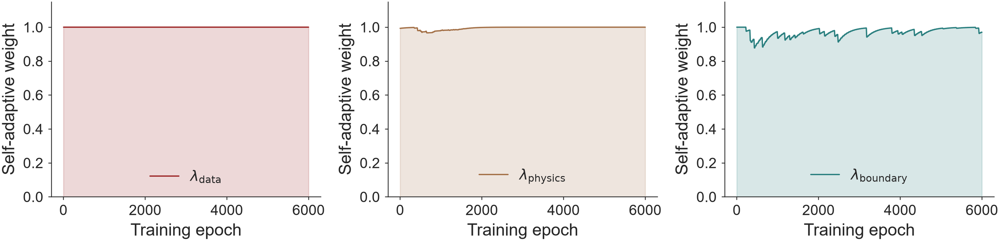
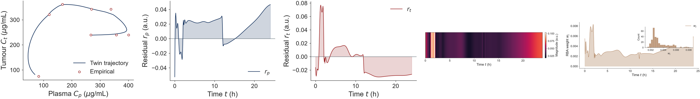
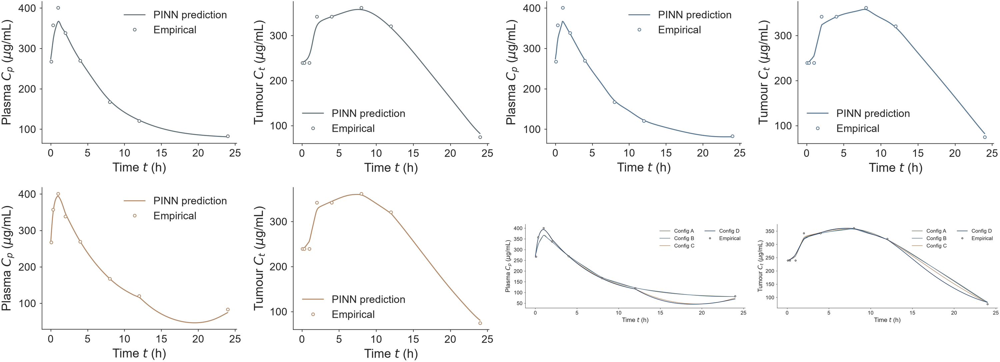
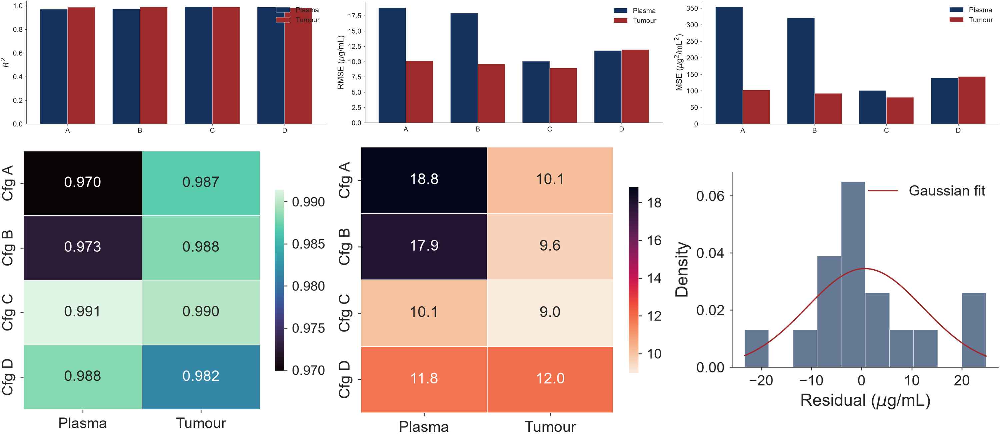
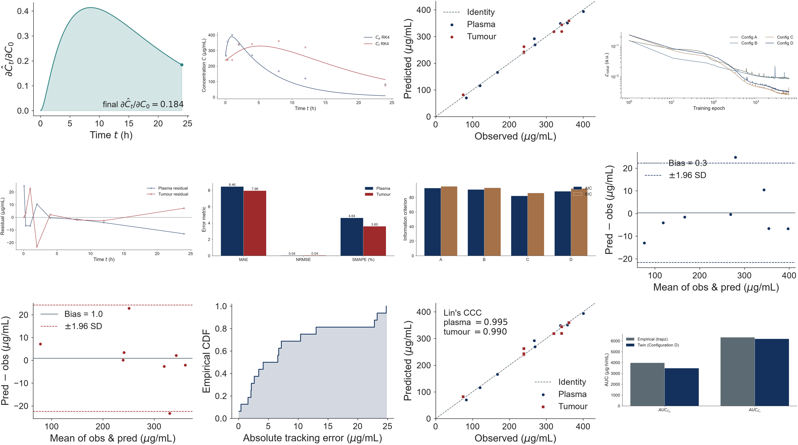

# Folate-Polymers-Twin

**A physics-informed neural network digital twin for tracking compartmental
uptake–retention dynamics in breast cancer nanomedicine**

[](https://github.com/MBJamshidi/Folate-Polymers-Twin/actions/workflows/tests.yml)


`folate_twin` is the open-source implementation accompanying the article
published in *ACS Omega*. It reconstructs continuous plasma and tumour
concentration–time trajectories of folate-targeted polymeric (PSMAC-PTX)
nanoparticles from sparse bioanalytical measurements, identifies the effective
kinetic rate constants of a two-compartment uptake–retention model, and exposes
the calibrated model as a fully differentiable digital twin.



---

## Contents

- [Highlights](#highlights)
- [Model](#model)
- [Installation](#installation)
- [Quick start](#quick-start)
- [Command-line interface](#command-line-interface)
- [Python API](#python-api)
- [Outputs](#outputs)
- [Reproducibility](#reproducibility)
- [Results and figures](#results-and-figures)
- [Repository layout](#repository-layout)
- [Testing](#testing)
- [License](#license)
- [Citation](#citation)

---

## Highlights

- **Inverse PINN.** Network weights and kinetic constants `{k10, k_in, k_out, k_a, C0}`
  are optimised jointly; the governing ODEs are enforced on 300 collocation
  points through automatic differentiation.
- **Deep Galerkin Method (DGM) surrogate** with gated hidden layers and a softplus
  output, so predicted concentrations are always non-negative.
- **Residual-Based Attention (RBA)** reweights collocation points toward
  high-residual transient windows.
- **Self-adaptive loss balancing** of data, physics and boundary terms by
  gradient-norm matching.
- **Differentiable RK4 digital twin** that returns dose sensitivities such as
  `dC_t/dC_0` by autograd, without finite differences.
- **Ablation A–D**, multi-seed reproducibility, leave-one-out and
  leave-one-time-point-out validation, 54 publication figures and Excel/CSV
  exports, all produced by one command-line tool.

## Model

The proposed model is an absorption-driven influx–outflux system with a systemic
input state `C_a(t) = C0 exp(-k_a t)`, which reproduces the rising plasma limb
observed during the first hour:

```text
dC_p/dt = k_a C_a - (k10 + k_in) C_p
dC_t/dt =           k_in C_p - k_out C_t
C_p(0) = 267.42 ug/mL,  C_t(0) = 239.50 ug/mL   (first sampling node)
```

| Symbol | Meaning |
| --- | --- |
| `C_p`, `C_t` | plasma and tumour concentration (µg/mL) |
| `k10` | apparent systemic elimination (1/h) |
| `k_in` | effective plasma-to-tumour uptake (1/h) |
| `k_out` | effective tumour clearance (1/h) |
| `k_a`, `C0` | systemic-input rate (1/h) and amplitude |

Time and concentration are normalised as `t̄ = t / 24 h` and `C̄ = C / 422.5 µg/mL`.
With `t̄`, the residuals carry the chain-rule factor `1/T_max`:

```text
r_p = (1/T_max) dC_p/dt̄ - k_a C_a + (k10 + k_in) C_p
r_t = (1/T_max) dC_t/dt̄ - k_in C_p + k_out C_t
```

Residual-based attention weights are `w_j = (|r_p,j| + |r_t,j|) / (Σ_k (|r_p,k| + |r_t,k|) + ε)`.

### Ablation configurations

| Config | Physics | Topology | RBA | Self-adaptive weights |
| --- | --- | --- | --- | --- |
| A | passive two-compartment | MLP | – | – |
| B | passive two-compartment | DGM | – | – |
| C | absorption-driven influx–outflux | DGM | – | – |
| **D** | absorption-driven influx–outflux | DGM | ✓ | ✓ |

### Dataset

Digitised plasma and tumour concentrations of folate-targeted PSMAC-PTX
nanoparticles in a murine breast-cancer model (`folate_twin.data.RAW_TARGET`):

| t (h) | 0.083 | 0.33 | 1 | 2 | 4 | 8 | 12 | 24 |
| --- | ---: | ---: | ---: | ---: | ---: | ---: | ---: | ---: |
| C_p (µg/mL) | 267.42 | 357.45 | 400.64 | 338.15 | 269.47 | 167.23 | 120.33 | 82.92 |
| C_t (µg/mL) | 239.50 | 239.50 | 239.50 | 341.98 | 341.98 | 361.52 | 320.74 | 74.54 |

### Training settings

| Setting | Value |
| --- | --- |
| precision | float64 |
| optimiser | Adam, learning rate 2e-3 |
| epochs | 6000 |
| collocation points `N_r` | 300 (uniform on `[0, 1]`) |
| surrogate | width 64, depth 3 |
| adaptive weights | update every 25 steps, EMA 0.9, clamp [0.1, 1] |
| RK4 twin | 240 steps over 24 h |
| seed | 0 (robustness: 0, 42, 123, 2025, 2026) |

## Installation

Python 3.10 or newer.

```bash
git clone https://github.com/MBJamshidi/Folate-Polymers-Twin.git
cd Folate-Polymers-Twin
python -m venv .venv
source .venv/bin/activate          # Windows: .venv\Scripts\activate
pip install -r requirements.txt    # exact versions used for the reference results
pip install -e .                   # installs the package and the `folate-twin` command
```

`pip install -e ".[test]"` also installs `pytest`. A CPU is sufficient; a CUDA
device is used automatically when available.

## Quick start

```bash
folate-twin train --quick           # 1-2 minute smoke run (200 epochs)
folate-twin reproduce               # the complete study, written to ./outputs
```

`python -m folate_twin <command>` is equivalent to `folate-twin <command>`.

## Command-line interface

| Command | What it does |
| --- | --- |
| `folate-twin train` | trains Configurations A–D (6000 epochs) and writes every result table and the Excel workbook |
| `folate-twin robustness` | multi-seed (C, D × 5 seeds), LOO (16 folds) and LOTPO (8 folds × C, D, physics-free control): 50 runs in parallel, resumable |
| `folate-twin figures` | figures 1–46 (PNG 300 dpi + PDF) from the result tables |
| `folate-twin robustness-figures` | figures 47–54 from the robustness tables |
| `folate-twin panels` | assembles the eight multi-panel article figures |
| `folate-twin reproduce` | all of the above, in order |

Common options: `--output-dir` (default `outputs`), `--epochs`, `--collocation`,
`--rk4-steps`, `--log-every N` (train); `--workers N`, `--aggregate-only`
(robustness); `--data-dir` (figures). Run `folate-twin <command> --help` for
details.

The figures can be redrawn from the shipped reference results without any
training:

```bash
folate-twin figures            --data-dir results --output-dir my_figures
folate-twin robustness-figures --data-dir results --output-dir my_figures
folate-twin panels             --panel-dir my_figures --output-dir my_panels
```

## Python API

```python
from folate_twin import ABLATION, DifferentiableRK4, load_target, train_configuration

normaliser, target = load_target()
config_d = ABLATION[3]                                     # Configuration D
result = train_configuration(config_d, target, normaliser) # 6000 epochs, seed 0

print(result.metrics)        # {'plasma': {'MSE', 'RMSE', 'R2'}, 'tumour': {...}}
print(result.final_rates)    # {'k10', 'k_in', 'k_out', 'k_a', 'C0'}

twin = DifferentiableRK4(result.params)
ct_24h, dct_dc0 = twin.state_sensitivity(result.final_rates["C0"])
print(f"C_t(24 h) = {ct_24h * normaliser.c_max:.2f} ug/mL, dC_t/dC_0 = {dct_dc0:.3f}")
```

| Module | Contents |
| --- | --- |
| `folate_twin.config` | precision, normalisation anchors, training defaults, ablation matrix |
| `folate_twin.data` | target matrix, `Normaliser`, `load_target` |
| `folate_twin.models` | `DGMLayer`, `DGMSurrogate`, `MLPSurrogate`, `KineticParameters` |
| `folate_twin.physics` | `physics_residuals`, `rba_weights` |
| `folate_twin.weighting` | `AdaptiveLossWeights` |
| `folate_twin.twin` | `DifferentiableRK4` (rollout, dose sensitivity) |
| `folate_twin.metrics` | `compute_metrics` (MSE, RMSE, R²) |
| `folate_twin.training` | `train_configuration`, `run_ablation`, `TrainResult` |
| `folate_twin.pipeline` | `run_pipeline` and the table writers |
| `folate_twin.robustness` | `run_robustness`, job matrix, statistics |
| `folate_twin.viz` | `render_figures`, `render_robustness_figures`, `compose_all` |

Importing `folate_twin` sets `torch.set_default_dtype(torch.float64)`; the
models are defined and trained in double precision.

## Outputs

All tables are written to `<output-dir>/tables`:

| File | Content |
| --- | --- |
| `metric_evaluation_matrix.csv` / `.xlsx` | MSE, RMSE, R² per configuration and compartment |
| `numerical_trajectories.csv` | dense Configuration D trajectories |
| `rk4_digital_twin.csv` | differentiable RK4 rollout of Configuration D |
| `training_history.csv` | losses, adaptive weights and rates every 10 epochs (A–D) |
| `dense_predictions_all.csv` | 200-point trajectories of A–D |
| `node_predictions.csv` | A–D evaluated at the eight sampling times |
| `physics_diagnostics_D.csv` | residuals `r_p`, `r_t` and RBA weights on the collocation grid |
| `figure_data_check.csv` | this run's RMSE / R² next to the reported values |
| `multiseed_*.csv` | seed-resolved metrics, parameters and trajectories |
| `loocv_results.csv`, `lotpo_trajectories.csv` | out-of-sample predictions |
| `robustness_summary.json` | mean ± SD, paired C-vs-D test, cross-validation scores |
| `robustness_raw.jsonl` | checkpoint of every robustness run |

Figures go to `<output-dir>/figures` (`figNN_*.png` / `.pdf`) and the article
panels to `<output-dir>/panels`.

## Reproducibility

- `results/` holds the reference outputs behind the article: all tables,
  figures 1–54 (PNG and PDF) and the robustness checkpoint. Running the
  pipeline never overwrites it; new runs go to `outputs/`.
- Every run is seeded (`torch.manual_seed`) and computed in float64. On a given
  machine and PyTorch build, repeated runs are bit-for-bit identical.
- Across PyTorch versions, BLAS libraries and CPU/GPU hardware, floating-point
  round-off accumulates over 6000 epochs, so retrained values can differ from
  the reported ones in the trailing digits. `figure_data_check.csv` lists
  both side by side after every `folate-twin train`. Use the versions in
  `requirements.txt` for the closest match.
- Each robustness worker runs with a single thread.
- `tests/test_training.py` pins short training runs of all four configurations
  to the values of the original implementation.

## Results and figures

Reported tracking accuracy (eight sampling times, µg/mL):

| Configuration | Plasma RMSE | Plasma R² | Tumour RMSE | Tumour R² |
| --- | ---: | ---: | ---: | ---: |
| A | 18.82 | 0.9699 | 10.14 | 0.9868 |
| B | 17.91 | 0.9728 | 9.61 | 0.9881 |
| C | 10.06 | 0.9914 | 8.97 | 0.9897 |
| D | 11.82 | 0.9881 | 11.96 | 0.9816 |

Recovered Configuration D constants (seed 0): `k10 = 0.0237`, `k_in = 0.1437`,
`k_out = 0.0914`, `k_a = 1.949` h⁻¹, `C0 = 0.502` (212.2 µg/mL). Across five
seeds the coefficient of variation of `k_in` and `k_a` stays below 1 %. The
terminal dose sensitivity of the twin is `dC_t(24 h)/dC_0 = 0.184`.

The eight multi-panel figures below are assembled from the individual figures in
`results/figures` with `folate-twin panels`.

**Figure 1. Configuration D state reconstruction.** Plasma and tumour fits and
the combined trajectory against the empirical data.



**Figure 2. Multi-objective convergence.** Total, physics, data and boundary
losses of Configuration D over 6000 epochs.



**Figure 3. Kinetic-parameter identification.** Convergence of `k10`, `k_in` and
`k_out` during training.



**Figure 4. Self-adaptive loss weights.** Evolution of the data, physics and
boundary multipliers.



**Figure 5. Physics diagnostics.** Phase portrait, plasma and tumour residuals,
residual magnitude map and residual-based attention weights.



**Figure 6. Ablation fits.** Plasma and tumour reconstructions of
Configurations A–C and overlays of all four configurations.



**Figure 7. Cross-model error statistics.** R², RMSE and MSE bar charts,
heatmaps and the Configuration D residual distribution.



**Figure 8. Digital-twin deployment and agreement analysis.** Dose-sensitivity
field, RK4 rollout, observed-vs-predicted concordance, loss comparison,
residual time series, error metrics, AIC/BIC, Bland–Altman plots, error ECDF,
Lin's CCC and exposure (AUC).



Figures 47–54 (multi-seed variance envelopes, parameter reproducibility and
leave-one-out / leave-one-time-point-out validation) are in `results/figures`.

## Repository layout

```text
Folate-Polymers-Twin/
├── src/folate_twin/
│   ├── config.py          precision, anchors, defaults, ablation matrix
│   ├── data.py            target matrix and normalisation
│   ├── models.py          DGM / MLP surrogates, kinetic parameters
│   ├── physics.py         ODE residuals, residual-based attention
│   ├── weighting.py       self-adaptive loss weights
│   ├── twin.py            differentiable RK4 digital twin
│   ├── metrics.py         MSE, RMSE, R²
│   ├── training.py        inverse-PINN training engine
│   ├── pipeline.py        train A-D and write all tables
│   ├── robustness.py      multi-seed, LOO and LOTPO suite
│   ├── cli.py             `folate-twin` command
│   ├── reference/         reported metric matrix
│   └── viz/               style, figures 1-46, figures 47-54, article panels
├── tests/                 pytest suite
├── results/               reference tables and figures
├── docs/figures/          graphical abstract and article figures
├── pyproject.toml
├── requirements.txt
├── CITATION.cff
└── LICENSE
```

## Testing

```bash
pip install -e ".[test]"
pytest -m "not slow"     # unit and regression tests (about 2 minutes on a CPU)
pytest                   # also renders all 54 figures and the eight panels
```

## License

Released under the [MIT License](LICENSE).

## Citation

This code, the data and the results are free to use, modify and redistribute
in any research area, **provided that the article below is cited** in any
publication, presentation, software or derived work that uses them.

> M. B. Jamshidi, M. Jamshidi, O. Moztarzadeh, V. Yaghoubi Naei and B. F. Yates,
> "A Physics-Informed Neural Network Digital Twin for Tracking Compartmental
> Uptake–Retention Dynamics in Breast Cancer Nanomedicine," *ACS Omega*, 2026.

```bibtex
@article{Jamshidi2026FolateTwin,
  author  = {Jamshidi, Mohammad (Behdad) and Jamshidi, Morteza and Moztarzadeh, Omid and
             Yaghoubi Naei, Vahid and Yates, Brian F.},
  title   = {A Physics-Informed Neural Network Digital Twin for Tracking Compartmental
             Uptake--Retention Dynamics in Breast Cancer Nanomedicine},
  journal = {ACS Omega},
  year    = {2026}
}
```

Machine-readable citation metadata is in [`CITATION.cff`](CITATION.cff).
